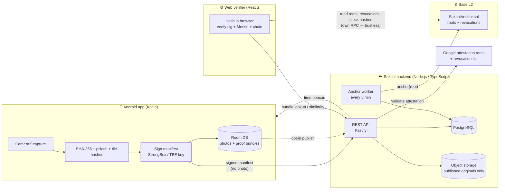
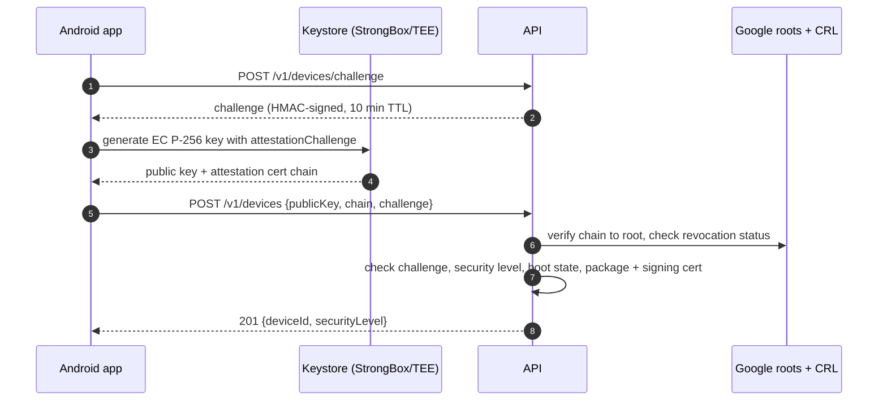
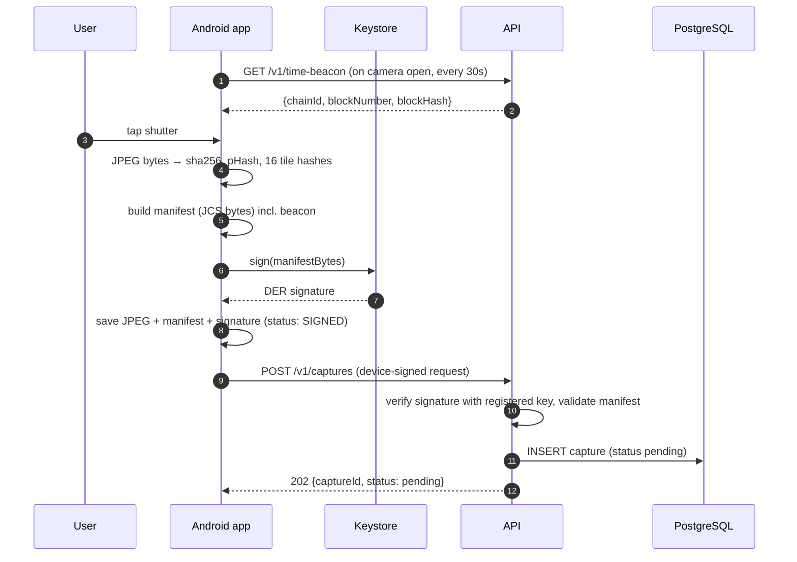
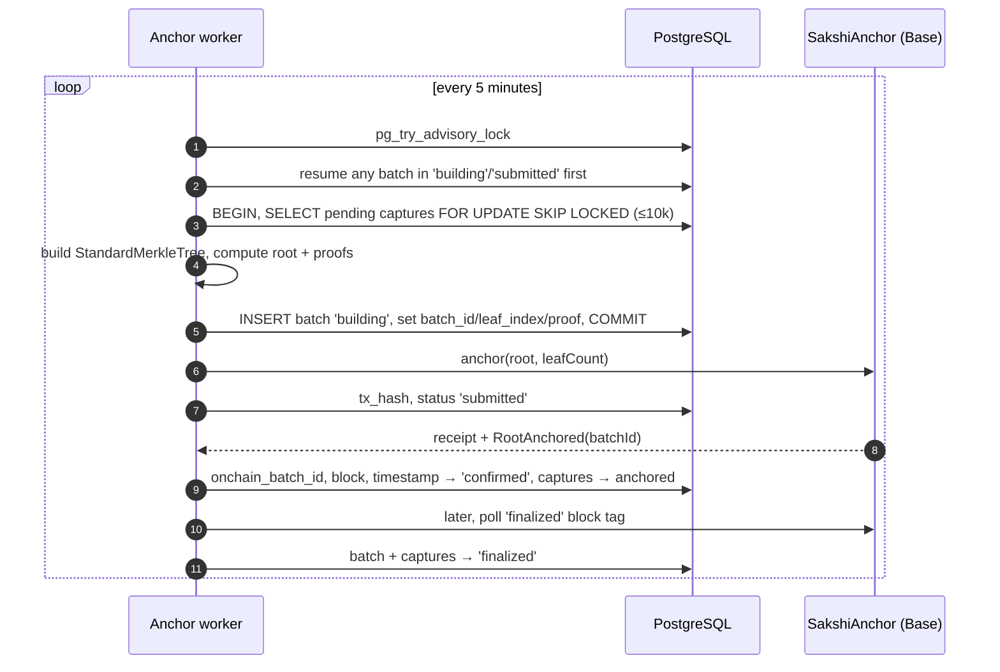
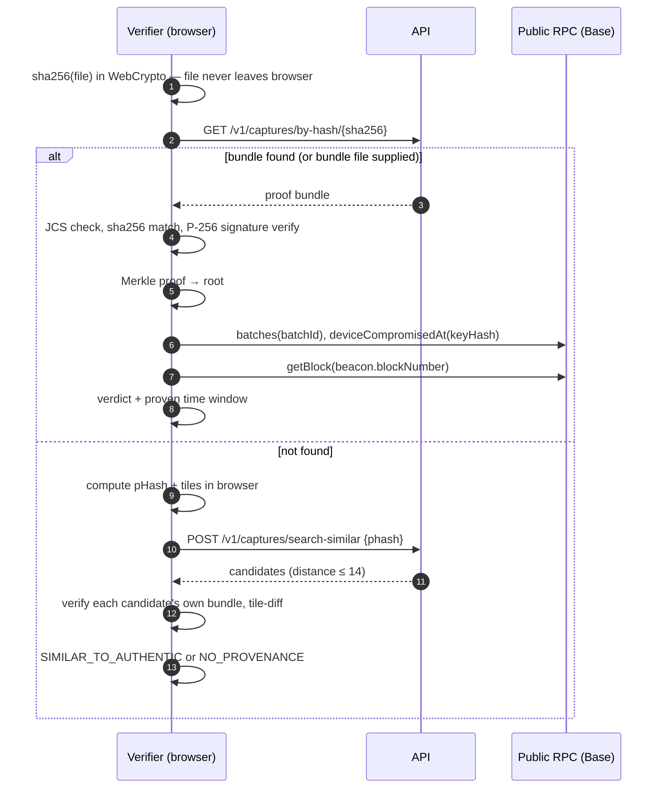
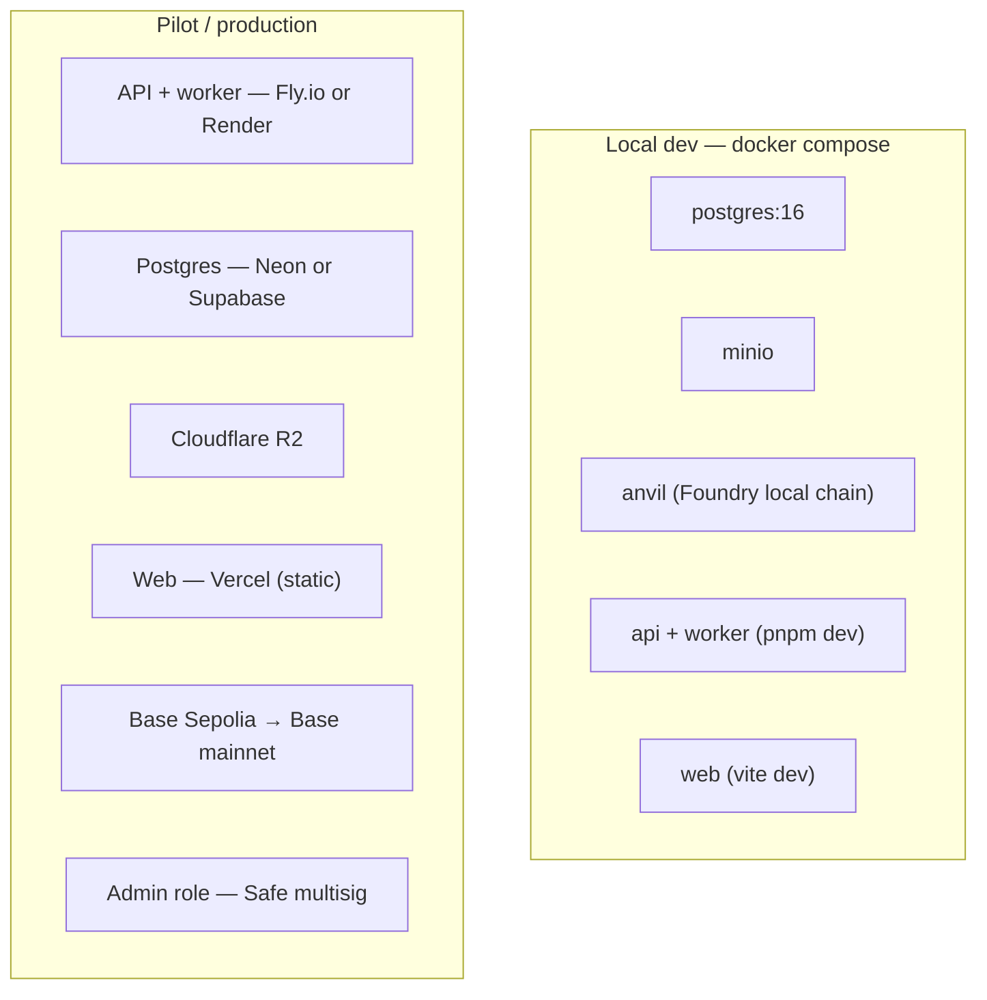

# Sakshi — Architecture

> Diagrams are Mermaid. They render on GitHub, and in VS Code with the *Markdown Preview Mermaid Support* extension.
> Wire formats, hashing, and the verification algorithm are specified in [PROTOCOL.md](PROTOCOL.md). This document covers the components and how they fit together.

---

## 1. System overview



**The core idea:** the phone's security chip signs a fingerprint of each photo the instant it's taken. The backend batches thousands of fingerprints into one Merkle root and writes it to a public chain every 5 minutes. Anyone can later re-hash a photo and check the signature and the on-chain root themselves, so the Sakshi server only *delivers* proofs and is never *trusted* for them.

---

## 2. Components

### 2.1 Android app — `apps/android`
| Concern | Choice |
|---|---|
| Language / UI | Kotlin, Jetpack Compose |
| Camera | CameraX `ImageCapture` → in-memory JPEG bytes (no gallery path exists) |
| Keys | Android Keystore, EC P-256, StrongBox with TEE fallback, Key Attestation |
| Local storage | App-private files for JPEGs. Room DB for manifests, signatures, bundles, status |
| Background upload | WorkManager (handles offline retries and backoff) |
| Network | Retrofit + OkHttp; request signing per PROTOCOL §9 |
| Min SDK | 28 (Android 9) |

Responsibilities: register the device, capture → hash → sign → persist → upload, poll status, export bundles, manage albums, opt-in publishing.

### 2.2 API — `apps/api`
| Concern | Choice |
|---|---|
| Runtime | Node.js 22 LTS, TypeScript (strict) |
| HTTP | Fastify + zod validation |
| DB access | `postgres` (porsager) with plain SQL, no ORM |
| Migrations | `dbmate` with plain `.sql` files in `apps/api/db/migrations` |
| Attestation | `@peculiar/x509` + `asn1js` to parse the KeyDescription extension |
| Chain | `viem` |
| Object storage | S3-compatible (`@aws-sdk/client-s3`): MinIO locally, Cloudflare R2 in prod |

Endpoints: [API.md](API.md).

### 2.3 Anchor worker — `apps/api` (separate process, same codebase)
It runs as `node dist/worker.js`. A Postgres advisory lock (`pg_try_advisory_lock`) guarantees only one instance anchors at a time.

### 2.4 Smart contract — `packages/contracts`
Solidity 0.8.x with Foundry and OpenZeppelin `AccessControl` + `MerkleProof`. It is **non-upgradeable**: a new version means a new deployment, and verifiers read `chainId + contract` from the bundle.

```solidity
contract SakshiAnchor is AccessControl {
    bytes32 public constant ANCHORER_ROLE = keccak256("ANCHORER_ROLE");
    bytes32 public constant REVOKER_ROLE  = keccak256("REVOKER_ROLE");

    struct Batch { bytes32 root; uint64 timestamp; uint32 leafCount; }
    Batch[] public batches;                                   // batchId = index
    mapping(bytes32 deviceKeyHash => uint64) public deviceCompromisedAt; // 0 = not revoked

    event RootAnchored(uint256 indexed batchId, bytes32 indexed root, uint32 leafCount);
    event DeviceRevoked(bytes32 indexed deviceKeyHash, uint64 compromisedAt, uint8 reason);

    function anchor(bytes32 root, uint32 leafCount) external onlyRole(ANCHORER_ROLE) returns (uint256 batchId);
    function revokeDevice(bytes32 deviceKeyHash, uint64 compromisedAt, uint8 reason) external onlyRole(REVOKER_ROLE);
    function verify(uint256 batchId, bytes32[] calldata proof, bytes32 leaf) external view returns (bool);
    function batchCount() external view returns (uint256);
}
```
Invariants (enforced by Foundry invariant tests):
- A batch is never modified or deleted once written.
- `root != 0` and `leafCount > 0` for every batch.
- Only `ANCHORER_ROLE` can append batches, and only `REVOKER_ROLE` can revoke.
- Revocation can only move `compromisedAt` **earlier** (never un-revoke, never move later).

### 2.5 Web verifier — `apps/web`
React + Vite + TypeScript, `viem` for chain reads, WebCrypto for SHA-256 and P-256 verification. It is a **static site** with no server-side logic, so it can also be hosted on IPFS. It uses a public RPC configured at build time, and the user can override it with their own RPC.

### 2.6 Shared core — `packages/core`
A TypeScript library used by **both** the API and the web app: JCS canonicalisation, manifest types, pHash/tiles, DER↔raw signature conversion, Merkle leaf helpers, and the full `verify()` algorithm (PROTOCOL §8). It contains the shared `test-vectors/` that the Kotlin tests also load.

---

## 3. Key flows

### 3.1 Device registration


### 3.2 Capture


### 3.3 Anchoring (worker)

Failure handling:
| Failure | Behaviour |
|---|---|
| Crash after COMMIT, before send | On restart, the `building` batch (root stored) is re-sent |
| Tx sent but hash not saved (crash) | It may be re-sent. A duplicate root on-chain is harmless; the first `RootAnchored` event wins |
| Tx stuck > 3 min | Replace with the same nonce and higher fees (viem) |
| Tx reverted | Batch → `failed`, its captures go back to `pending`, alert raised |
| L2 reorg before finality | `finalized` is only set from the `finalized` block tag. Confirmed-but-reorged batches are re-checked by receipt |

### 3.4 Verification (browser)


---

## 4. Trust model: who is trusted for what

| Party | Trusted for | NOT trusted for |
|---|---|---|
| Phone security chip (StrongBox/TEE) | Keeping the key secret; signing only what the app gives it | — |
| Google attestation root | Vouching that a key lives in genuine hardware | — |
| Sakshi app (verified by attestation) | Only signing fresh camera frames | — |
| Sakshi server | Availability (delivering bundles, anchoring promptly) | **Correctness.** It cannot forge signatures, backdate anchors, or alter roots |
| Base L2 + Ethereum L1 | Ordering and timestamps of anchors | — |
| Device clock | Nothing. `capturedAt` is displayed as a claim only | Time |

The worst a malicious server can do is **refuse service** (withhold bundles or not anchor). Users keep bundles locally, and the verifier accepts bundle files, so even that is survivable.

---

## 5. Deployment



| Env | Chain | Chain ID |
|---|---|---|
| local | Anvil | 31337 |
| staging / pilot | Base Sepolia | 84532 |
| production | Base | 8453 |

---

## 6. Repository layout

```
sakshi/
├── apps/
│   ├── android/          # Kotlin app (Gradle)
│   ├── api/              # Fastify API + anchor worker
│   │   └── db/migrations # dbmate SQL migrations (schema source of truth)
│   └── web/              # React verifier (static)
├── packages/
│   ├── contracts/        # Foundry: SakshiAnchor.sol, tests, deploy scripts
│   └── core/             # shared TS: protocol, pHash, merkle, verify()
│       └── test-vectors/ # JSON vectors shared with Kotlin tests
├── docs/
├── docker-compose.yml
├── pnpm-workspace.yaml
└── .github/workflows/ci.yml
```

---

## 7. Key decisions

| # | Decision | Why | Rejected alternative |
|---|---|---|---|
| D1 | **Sign on the device with hardware keys** | Only proof made at capture time can beat AI fakes. Hardware keys can't be copied | Server-side signing — it proves nothing about the camera |
| D2 | **P-256, not secp256k1** | Android Keystore only supports NIST curves. WebCrypto verifies P-256 natively | secp256k1 — would need a software key, which defeats D1 |
| D3 | **Merkle batching every 5 min** | Cost is constant regardless of photo volume (one tx per 5 min) | One tx per photo — cost grows linearly |
| D4 | **Base L2** | Cheap gas, EVM tooling, inherits Ethereum security, good testnet faucets | Ethereum L1 (too expensive), private chain (no public trust) |
| D5 | **Photos stay on the phone** | Privacy, and less liability for us | Upload everything — a privacy risk and a cost |
| D6 | **Block-hash time beacon** | Proves "not before", so a time *window* is proven, not just an upper bound | Trusting the device clock |
| D7 | **Perceptual + tile hashes** | Survives WhatsApp recompression and localises edits | Exact hash only — breaks on any forward |
| D8 | **Postgres, not The Graph** | One store for captures, search, and albums. Anchors can be rebuilt from chain events | The Graph — extra infrastructure for a single contract |
| D9 | **Non-upgradeable contract** | Simpler to audit, with no admin backdoor to change history | UUPS proxy — upgrade power contradicts immutability |
| D10 | **Device-key request auth, no accounts** | No passwords and nothing to leak. The key is already hardware-backed | Email/password — more attack surface for v1 |
| D11 | **Plain SQL + dbmate** | The schema is readable by anyone, with no ORM magic | Prisma/TypeORM — the abstraction isn't worth it here |
