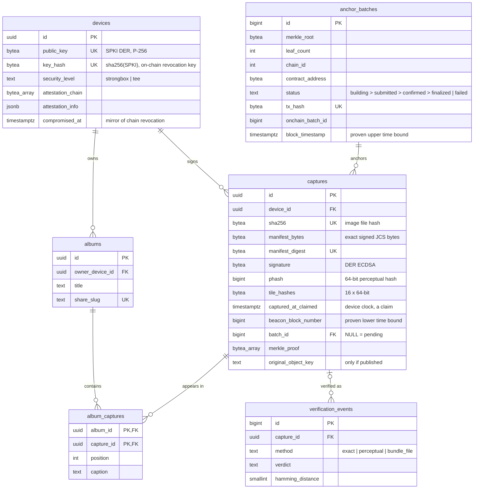

# Sakshi — Database

**Source of truth:** [`apps/api/db/migrations/`](../apps/api/db/migrations/) (dbmate, plain SQL). This document explains the schema; when the two disagree, the migrations win.

PostgreSQL 16+ (validated on 18). Extensions: none (`gen_random_uuid()` and `bit_count()` are built in).

---

## 1. Entity-relationship diagram



---

## 2. Tables

| Table | Purpose | Notes |
|---|---|---|
| `devices` | One row per app install (hardware key) | Created only after attestation passes. `compromised_at` mirrors the on-chain revocation; the chain is authoritative |
| `captures` | Signed photo fingerprints | **No photo bytes.** `manifest_bytes` are stored verbatim because re-serialising would break the signature |
| `anchor_batches` | One Merkle root = one on-chain tx | Status lifecycle drives the worker. `block_timestamp` is the proven "existed no later than" time |
| `albums`, `album_captures` | Shareable groups ("Room 204 — move-in") | The API checks that album captures belong to the owner's device |
| `verification_events` | Anonymous outcome counts for metrics | Deliberately stores no IP or user agent |

---

## 3. Design decisions

1. **Capture status is derived, not stored.** `batch_id IS NULL` means pending; otherwise the status is `anchor_batches.status`. With one place to update, it can't go out of sync. A failed batch resets its captures' `batch_id` to `NULL`.
2. **One in-flight batch.** The partial unique index `anchor_batches_one_inflight` lets at most one batch be `building` or `submitted` at a time. That makes nonce handling and crash recovery trivial. At one batch per 5 minutes, serial anchoring is never the bottleneck.
3. **All-or-nothing column groups** use `CHECK (num_nulls(...) IN (0, 3))`: the beacon fields, the batch assignment fields, and publish fields. Half-written states are impossible.
4. **`bytea` for all hashes and keys**, with exact length checks. It's half the size of hex text and compares faster. Hex conversion happens at the API boundary.
5. **pHash as `BIGINT`.** 64 bits fit exactly, and Hamming distance is `bit_count((a # b)::bit(64))`.
6. **The chain is authoritative for anchors and revocations.** If the database is lost, batch data can be rebuilt from `RootAnchored` events. Proofs can also be recomputed, because users' devices hold bundles and the manifests are re-submittable.

---

## 4. Key queries

**Pending captures for the next batch (worker):**
```sql
SELECT id, manifest_digest, signature
FROM captures
WHERE batch_id IS NULL
ORDER BY received_at
LIMIT 10000
FOR UPDATE SKIP LOCKED;
```

**Perceptual similarity search:**
```sql
SELECT id, bit_count((phash # $1::bigint)::bit(64)) AS distance
FROM captures
WHERE bit_count((phash # $1::bigint)::bit(64)) <= 14
ORDER BY distance
LIMIT 10;
```
> This is a sequential scan. At ~1 M rows it takes roughly 100 ms, which is fine for the pilot. **Upgrade path:** multi-index hashing (split the 64 bits into 4 × 16-bit chunks, index each, and use the pigeonhole principle to get candidates for distance ≤ 3, or more chunks for higher thresholds), or a BK-tree service.

**Capture status (for app polling):**
```sql
SELECT c.id, COALESCE(b.status, 'pending') AS status, b.tx_hash, b.block_timestamp
FROM captures c LEFT JOIN anchor_batches b ON b.id = c.batch_id
WHERE c.id = $1;
```

---

## 5. Data retention and privacy

| Data | Retention |
|---|---|
| Captures (hashes + manifests) | Indefinite. They're needed to serve proofs, and they contain no image |
| Published originals (object storage) | Until the owner unpublishes. Unpublish deletes the object and clears `original_object_key` |
| Location | Only inside `manifest_bytes`, only when the user opted in, coarse (≈110 m) |
| Verification events | Aggregate metrics; no personal data |

> Note: a manifest with location is visible to **anyone who holds the photo** (they can look it up by hash). The app explains this when the user opts in.
